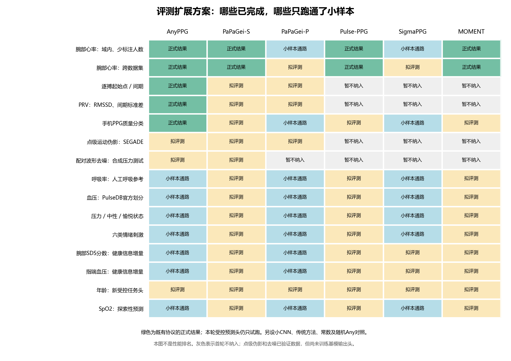
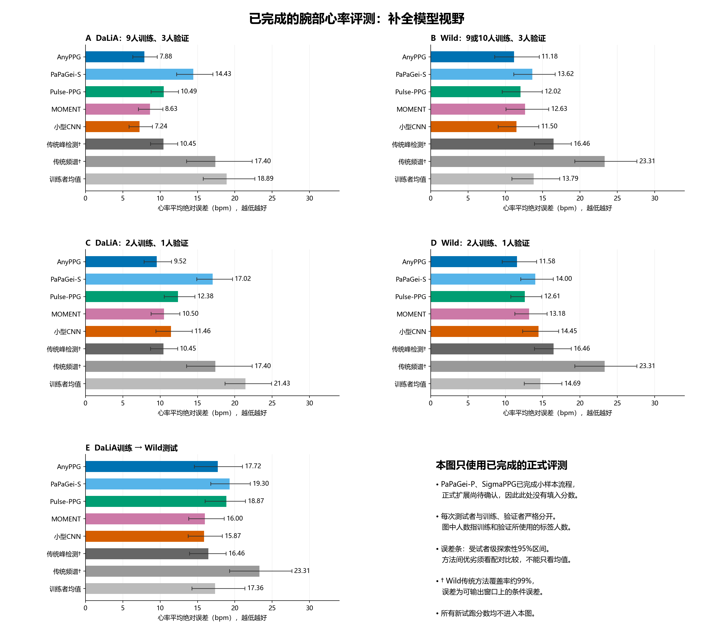

# PPG评测扩展方案与小样本流程验证

2026-11-05，Asia/Shanghai。**本轮完成模型/数据/任务梳理与小样本流程，正式扩展等待用户确认。没有启动基模预训练、编码器微调或历史全套队列。** 小型CNN和任务头的短程拟合属于流程验证。

建议把下一阶段组织为“腕部信号测量、健康相关表征、临床辅助验证”三部分。充分使用现有数据，同时区分真实患者、采集记录和片段；不把任务数量或基模胜出率作为验收条件。

## 先解释原来的说法

“全预算”原意是：先留出测试受试者，再使用其余可用的训练和验证标签。它不是训练时使用整个数据库，更不是使用测试标签。以后面向用户改写为具体人数或“使用全部可用训练/验证标签”。

| 旧说法 | 实际含义 | 以后采用的表达 |
| :--- | :--- | :--- |
| DaLiA全预算 | 每折9人拟合、3人选参数，另3人测试 | 9人训练、3人验证 |
| Wild全预算 | 每折9或10人拟合、3人验证，另4或3人测试 | 9或10人训练、3人验证 |
| 3人标签预算 | 2人拟合、1人验证；每人的全部有效窗口可用 | 2人训练、1人验证 |
| 6人标签预算 | 4人拟合、2人验证 | 4人训练、2人验证 |
| 域内 | 在同一数据集训练，测试未参与训练的人 | 同数据集、不同受试者测试 |
| 跨域迁移 | 在DaLiA训练/选参数，直接测试Wild | DaLiA训练、Wild测试 |
| 冻结编码器 | 已下载模型的参数保持不变 | 保持预训练模型不变，只拟合预测器 |
| 任务头 | 把模型提取的特征转成HR、类别等输出的小预测器 | 首次出现解释为“小预测器” |
| 小样本试跑 | 只验证读取、划分、推理、拟合和评分能正确连接 | 流程验证，不能据此判定方法优劣 |

“2人训练、1人验证”是少受试者标签实验，不等于只标注几分钟。之后另设固定分钟数实验时，必须明确连续片段、非重叠时长和验证标签成本，不能混用。

## 模型与对照方案

| 对象 | 选择理由 | 本轮实测状态 |
| :--- | :--- | :--- |
| AnyPPG | ECG引导PPG预训练；沿用已完成结果 | 两份腕部数据及多个新任务真实冻结前向 |
| PaPaGei-S | 形态相关预训练路线 | 两份腕部数据的统一小样本流程通过 |
| PaPaGei-P | 同人不同片段对比，与Apple 2024人级表征思想有关 | HR、质量、血压、健康增量等流程通过 |
| Pulse-PPG | 野外腕部预训练 | 两份腕部数据的统一小样本流程通过 |
| SigmaPPG | 掩码重构预训练路线 | HR、质量、血压、呼吸等流程通过 |
| MOMENT-1-small | 通用时序模型，检验PPG专用预训练的额外价值 | 两份腕部数据的统一小样本流程通过 |
| AnyPPG同架构随机初始化 | 检验预训练特征的贡献 | 新建官方网络，不读权重；参数数相同、状态不同 |
| 小型CNN | 从随机初始化训练的任务专用对照 | HR小样本短程拟合通过；沿用既有逐搏/SQI对照 |
| 传统算法/特征、训练者均值或类别比例 | 生理知识与低成本基准 | 按任务设置，不用单个弱算法代表全部传统方法 |

首六个预训练模型进入标量回归/分类的统一比较。逐点输出首轮采用AnyPPG、PaPaGei-S/P的时序特征，配参数规模接近的输出头；不能拿全局平均表征直接当逐搏序列。配对去噪先限制AnyPPG/PaPaGei-S与小CNN/滤波对照。其余模型逐点接口列后续研究，不因暂未纳入而判差。

统一比较两种小预测器：线性模型与小MLP。HR试跑中，特征先仅用训练人拟合标准化和16维PCA，再分别接17参数线性头和289参数MLP；同一模型两头使用相同16个特征。PCA是训练集拟合的降维变换，虽然没有神经网络梯度，也属于已拟合的预处理，不能说整个流程只拟合17/289个数。健康增量试跑因训练人更少固定8维。正式比较将保留原始全维线性探测作为参考，并将受控头单独列出，不覆盖历史结果。

随机冻结编码器只能检验随机特征与预训练特征的差别，不能替代从头监督训练的CNN；两者都保留。暂不开展基础模型预训练或编码器微调。

## 拟测任务与数据

下表按科学问题列出任务，训练人数、运动分层、跨数据集属于评测场景，不作为新任务重复计数。收缩压/舒张压分别输出；逐搏F1与时间误差、PRV各统计量也同时报告，不合成总分。

| 科学问题 | 数据与实际范围 | 参考/指标 | 建议地位及当前状态 |
| :--- | :--- | :--- | :--- |
| 1. 运动中的窗口心率 | DaLiA15人、Wild16人 | ECG参考HR；逐人MAE、偏差、覆盖率 | 核心；补PaPaGei-P/Sigma，增加受控头/随机对照 |
| 2. 脉搏起始点与间期 | EMBC21/Biagetti7人 | 单专家PPG起始点；F1、匹配时间/间期误差、覆盖率 | 核心；增加PaPaGei变体与种子，仍需独立人工数据 |
| 3. PRV统计恢复 | 同上，连续60秒为主 | RMSSD、间期标准差误差 | 核心；PPG参考一致性，不称临床ECG HRV验证 |
| 4. 信号质量分类 | BUT完整3888条/50人 | 专家HR可读性；AUROC、AUPRC、平衡准确率 | 辅助采集域；补完整模型比较 |
| 5. 点级运动伪影 | SEGADE对DaLiA的标注 | 点级F1、敏感度、特异度，按人汇总 | 腕部扩展；24行已严格映射，全4305行映射为正式前置 |
| 6. 配对波形去噪 | EPFL一段72秒clean及340 noisy副本 | RMSE、SNR、相关性，另看脉搏信息保留 | 合成压力测试；数据/传统滤波通路完成，不能训练/测试随机拆副本 |
| 7. 呼吸率 | BIDMC53采集记录/46真实患者 | 两名人工呼吸标注；32秒窗口逐人MAE | 临床辅助；新患者划分和人工参考小样本已通过 |
| 8. 血压回归 | PulseDB已有955份波形文件；正式索引覆盖另核对 | 官方SBP/DBP；逐人MAE、误差均值/标准差、分布分层 | 临床辅助；128段按需映射与预测已通过，非AAMI器械认证 |
| 9. 压力/中性/愉悦状态 | WESAD15人腕部PPG | 实验状态三分类；宏F1、平衡准确率 | 腕部扩展；8人流程通过，非精神疾病诊断 |
| 10. 情绪刺激类别 | ECSMP本机有效腕BVP60人 | 六类视频刺激；宏F1、平衡准确率 | 次要；8人流程通过，刺激类别不等于真实主观情绪 |
| 11. SDS症状分数的信息增量 | ECSMP60人，18–28岁 | SDS连续分数；MAE、加入表征前后的配对误差变化 | 腕部健康主候选；30人流程通过，非抑郁症确诊 |
| 12. 血压信息增量 | PPG-BP218人、每人3段2.1秒指端PPG | SBP/DBP；在年龄/性别/BMI/传统测量上增加表征 | 指端补充；60人流程通过，不等同手表血压 |
| 13. 年龄表征 | PPG-BP，同上 | 年龄MAE；性别/BMI/传统特征基线 | 次要；已有旧线性结果，新受控头尚未跑；不是血管年龄 |
| 14. SpO2预测 | BIDMC同一患者划分 | 监护仪SpO2；MAE、偏差、低值分层 | 探索性；单路PPG缺标准双波长比值条件，不能称血氧仪测量验证 |

建议下一轮正式结论优先覆盖1–5、7–9、11–12；6、10、13–14作为明确标记的辅助/探索性结果。因数据共享，多个标签任务可复用同一份冻结特征，避免按任务重复运行编码器。

## 现有数据为何仍有一些保留为后续

| 数据 | 本轮核查/选择 |
| :--- | :--- |
| MIMIC-PERForm | 本机两份MAT各200条，含PPG/ECG/阻抗呼吸与源记录ID。可扩连续呼吸/心搏研究，但尚未逐一核对真实患者映射、呼吸参考及与预训练队列重合；先以BIDMC人工呼吸参考闭环，不把400个记录ID直接当独立患者证明 |
| VitalDB 1-min | 本机50个case文件，示例含PPG、ECG、caseid、采样率、60秒窗；没有ABP字段，也没有每窗原始时间起点。不能直接承担当前BP真值或跨窗口PRV；后续需回到原始时间轴/标签补齐 |
| RealWorldPPG | 2074条采集记录、35人，主要可用身份标签。身份识别要求同一人出现在训练/测试、按采集记录分隔，与健康跨人泛化不同；首轮不作为健康能力主任务 |
| PPG-BP疾病标签 | 218人中糖尿病明确记录37条、脑梗20条、脑血管疾病25条，其余病种字段为空；不能未经定义核查就把所有空白当医学确认阴性。先用完整连续BP标签，不将弱证据疾病分类凑入主结论 |
| DREAMT | 用户此前同意暂缓，项目文件权限仍未获得；不自动重新要求登录或反复申请 |
| CAS-BP | 本机为示例和申请资料，不是完整腕部BP队列；作者申请与原始波形获得后再规划，不把示例当1272人已就绪 |
| TROIKA/PhysioNet Wrist | 可作为未来独立强运动HR验证；本轮先补直接需要的参考/噪声文件，未额外启动整套下载 |

公开预训练模型与PulseDB、MIMIC、VitalDB等源队列可能重叠。官方下游训练/测试隔离不自动等于编码器从未见过测试患者。临床辅助结果必须保留预训练暴露说明；不能以此单独宣称严格未知患者的临床泛化。

## Apple式健康信息增量如何测

选择ECSMP腕部SDS连续分数为主候选、PPG-BP连续血压为指端补充。两者均使用一个人一条下游样本，汇聚相同观察区间的表征。ECSMP固定中性视频内连续120秒；原始BVP连续读取，附2秒滤波边界上下文，不拼接筛选后的离散窗。PPG-BP每人三个2.1秒独立片段可平均表征，但不计算长窗PRV。

| 对照输入 | 用途 |
| :--- | :--- |
| 年龄、性别（PPG-BP另含BMI） | 不使用PPG表征时的已知信息 |
| 人口学加传统HR/PRV/形态特征 | 已有生理算法能提供多少信息；短片段不硬算PRV |
| 仅PPG表征 | 表征独立预测能力 |
| 人口学加PPG表征 | 控制人口学后的表现 |
| 人口学加传统特征加PPG表征 | 是否在已有信息基础上仍有可重复改善 |

PPG-BP传统基线还保留原表HR，为较强临床测量对照；预测血压时不输入血压或由该血压直接定义的病种标签。年龄作为预测目标时，从协变量中去掉年龄。

本轮两任务均跑通，但没有稳定收益结论；正式实验应保留包括不利结果在内的全部预定比较。ECSMP是年轻健康大学生的症状自评，不能推广成抑郁诊断或未来发病风险。[ECSMP官方数据](https://data.mendeley.com/datasets/vn5nknh3mn/2)、[PPG-BP原文](https://doi.org/10.1038/sdata.2018.20)

这个设计借鉴Apple 2024的人级表征/健康任务，并进一步明确组合特征的增量检验。它不是Apple工业模型复现，人数、传感器、观察时长和标签都不同。[Apple 2024原论文](https://arxiv.org/html/2312.05409v2)

## 本轮实际跑通到哪里

| 流程 | 实际规模 | 核查结果 |
| :--- | :--- | :--- |
| 六基模＋随机Any，两种受控头，HR对照 | DaLiA/Wild各3训练、1验证、2测试人；各144窗；36份预测 | 14个编码器状态不变，独立重拟合14项Ridge最大差8.53e-14 bpm，14项MLP重载差0 |
| PulseDB读取→特征→SBP/DBP预测 | 8训练、4验证、4官方CalFree测试患者；每人8段、共128段 | 每条官方位置/患者/标签一致；Any/PaPaGei-P/Sigma真实冻结前向，传统与均值对照；AAMI仅验读2条映射 |
| 人工呼吸率及SpO2 | BIDMC8患者，4训练/2验证/2测试；59个32秒窗 | 两名标注者差≤2次/分；使用MATLAB一基采样点正确归窗；人工参考独立重建差≤2.13e-14 |
| 状态、刺激与质量分类 | WESAD/ECSMP各8人144窗；BUT8人32条 | Any/PaPaGei-P/Sigma＋手工特征＋常数；与BIDMC共25项指标独立复算差≤1.11e-16，379行源数据/标签回查通过 |
| 腕部健康信息增量 | ECSMP18训练/6验证/6测试人；每人连续120秒 | Any/PaPaGei-P与五类输入组合，8组小预测器 |
| 指端血压信息增量 | PPG-BP40训练/10验证/10测试人 | 两模型、两个目标，16组小预测器；两健康任务24组独立线性重拟合最大差2.20e-12 |
| 人工伪影标注映射 | SEGADE train/test各12条30秒采集片段 | 24/24唯一对应原始DaLiA人/时间，全部1920点误差0；72个8秒切片标签/传统HR输出通过，未做伪影分类训练 |
| 配对噪声数据 | EPFL 1条clean、340条noisy | 全部长度/有限值通过，3档噪声×原输入/固定滤波共6个流程示例；没有基模去噪结果 |

SEGADE匹配发现：公开数组已对每个30秒片段做0.9–5 Hz二阶因果滤波和min-max归一化，不能称未处理原始PPG。抽样train来自12人、test来自3人，没有交集；完整4305行的唯一对应仍须检查，不能用24条代替全量证据。官方数组行KFold也不能直接当按人交叉验证。[SEGADE固定源码](https://github.com/chengstark/Segade/tree/f5b2ad6e180a1474bc47d6c5ec5d482edaed6797)

本轮新增111个已校验下载文件，共179,594,187字节（约179.6 MB）：BIDMC 106个人工标注/人口学补充文件、SEGADE四个数组、EPFL压缩包；另保存BIDMC官方校验清单。EPFL解压后包含340条合成噪声信号和生成代码。未下载完整PulseDB或新增模型权重，无新依赖。[恢复清单](../data_manifests/ppg_expansion_assets.json)、[EPFL官方数据](https://zenodo.org/records/4981140)、[BIDMC官方数据](https://physionet.org/content/bidmc/1.0.0/)

## 本轮发现的历史BIDMC划分问题

新补齐的官方`Fix.txt`显示：53条采集记录对应46个MIMIC-II患者。患者s03386有06/07/08/09四条，s11342有20/21/22/23四条，s25323有38/39两条。

对先前独立数值复核的AnyPPG/PaPaGei-S共100项结果重新查真实患者身份，其中**92项的训练与测试存在同一患者的不同采集记录**，25种划分/种子中23种受影响。旧数值仍复现原上游协议，但原“53受试者无交集”的表述只核对了记录编号，不能作为严格跨患者泛化结论。旧预测/指标保留，不覆盖；新呼吸率评测改用真实患者分组和人工参考，与旧10秒监护仪RR任务另列。[逐折身份审计](results/ppg_expansion_pilot/bidmc_identity_audit.json)

## 待确认的正式执行顺序

1. **补模型与强对照。** 先补PaPaGei-P/Sigma的统一HR；复用其余四模型已核验特征。比较六模型的线性/小MLP、随机Any和小CNN，沿用原固定测试人；同时补完整BUT质量分类。新受控头与旧全维线性结果分别报告。
2. **扩展腕部任务。** WESAD状态、ECSMP SDS信息增量优先；六类刺激和年龄作为次要表征任务。健康增量采用全部可用受试者的按人五折、3个训练种子，验证人仅用于选参。SDS连续分数为主，不把少数高分者硬分成临床病例。
3. **完成临床辅助验证。** BIDMC按46个真实患者五折/3种子，采用32秒人工呼吸参考；SpO2只作探索性任务。PulseDB先在现有文件覆盖中按官方Train/CalFree规则，最多100人训练、20人验证、50人测试，每人最多50个10秒片段；实际可用名单先固定并审计，不足时明确报告。AAMI留作最后独立核验，不能拿其标签开发模型；不全量下载602GB。
4. **加强逐搏与噪声实验。** EMBC21补PaPaGei变体、3个种子及随机编码器；先完成SEGADE全行身份映射再按人划分。EPFL用于固定的合成外部压力测试；若训练波形恢复头，需另从按人隔离的干净区域构造合成配对，不能在同一72秒clean的不同噪声副本之间宣称跨人测试。

每项正式研究锁定输入观察时长、标签、测试人、候选参数和主指标后再运行。不同模型共享测试样本与可用观察时长；例如MOMENT原生8秒，可对完整10/32/120秒观察区间按固定8秒片段覆盖并汇聚，对其他模型采用相同覆盖策略作为单独的新协议，避免悄悄截掉标注区间。逐点任务不采用这种全局汇聚。

对照按人加权、报告配对差异与区间；在任务内预先指定主要比较并处理多重比较，其他分层明确标探索。传统方法除通用形态/频谱特征，还需加入任务相关算法：呼吸率的幅度/基线/间期调制，血压的形态特征回归，逐搏与SQI沿用已核验实现。试跑中的简易特征不宣称传统最优水平。

这四步是待批准的执行方案，不是已启动队列。没有必要为此引入生产级调度系统、安装WSL或开展基模预训练。最终交付原单位多任务对比图、少标签曲线、健康信息增量图，以及清楚标注模型/任务缺项的矩阵。

## 图与复现证据



[覆盖图SVG](results/ppg_expansion_pilot/evaluation_coverage.svg) · [覆盖状态数据](results/ppg_expansion_pilot/evaluation_coverage.json)



[心率图SVG](results/ppg_expansion_pilot/completed_hr_model_comparison.svg) · [图中数值](results/ppg_expansion_pilot/completed_hr_plot_values.json) · [原跨任务综合图](ppg_phase2_results.md)

图中的性能数字仍来自第一、二阶段正式结果，新小样本分数不填入胜负图。原跨任务图的“预算”标题也已替换为直接说明训练/验证人数，数值不变。

本机186项测试通过。证据入口：[模型审计](results/ppg_expansion_pilot/models_pilot_audit.json)、[PulseDB独立核验](results/ppg_expansion_pilot/pulsedb_independent_check.json)、[附加任务独立核验](results/ppg_expansion_pilot/additional_tasks_independent_check.json)、[ECSMP健康核验](results/ppg_expansion_pilot/health_ecsmp_audit.json)、[PPG-BP健康核验](results/ppg_expansion_pilot/health_ppg-bp_audit.json)、[伪影映射](results/ppg_expansion_pilot/artifact_reference_pilot.json)、[去噪数据](results/ppg_expansion_pilot/denoising_data_pilot.json)。原始输入、逐条预测和拟合权重保留`.local/ppg-expansion-pilot/`。

复现命令均只运行小样本，不能当正式实验启动器：

```powershell
# 补充文件按需下载；已存在文件核验，不重下模型或完整PulseDB。
.venv/Scripts/python.exe scripts/prepare_ppg_expansion_assets.py --datasets bidmc segade epfl

# 主环境读取PulseDB，独立benchmark环境负责已有模型。
.venv/Scripts/python.exe scripts/pulsedb_pilot.py
.local/ppg-bench-venv/Scripts/python.exe scripts/pulsedb_pilot.py --foundation-only --foundation-models AnyPPG PaPaGei-P SigmaPPG --shared-report docs/results/ppg_expansion_pilot/pulsedb_pilot.json
.local/ppg-bench-venv/Scripts/python.exe scripts/ppg_model_expansion_pilot.py
.local/ppg-bench-venv/Scripts/python.exe scripts/ppg_additional_tasks_pilot.py
.local/ppg-bench-venv/Scripts/python.exe scripts/ppg_health_increment_pilot.py
.venv/Scripts/python.exe scripts/ppg_artifact_reference_pilot.py
.venv/Scripts/python.exe scripts/ppg_denoising_data_pilot.py

# 只靠Git内表格即可重绘。
.venv/Scripts/python.exe scripts/plot_ppg_expansion_overview.py
```

本轮调研仓核对到[`9882df06694f1fa607467b8219c03d0a7cfed220`](https://github.com/tujy859/Wearable-Physiological-Foundation-Models/tree/9882df06694f1fa607467b8219c03d0a7cfed220)，阅读公开数据专题并回查对应官方资料。调研中的数据人数/标签描述不替代本机逐文件核验，例如ECSMP正式入口、BUT人数、BIDMC患者数均按原始证据记录。
