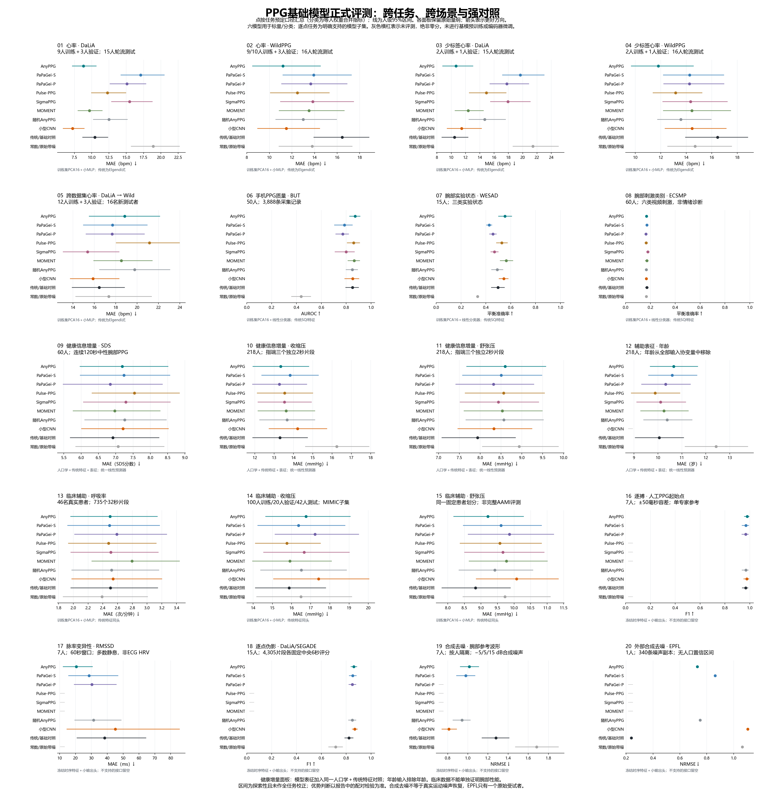
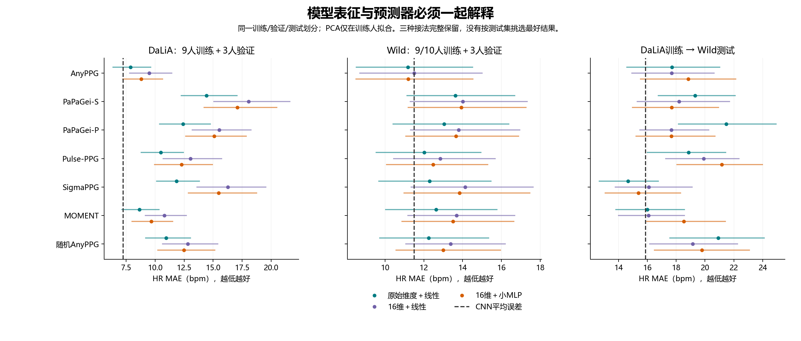
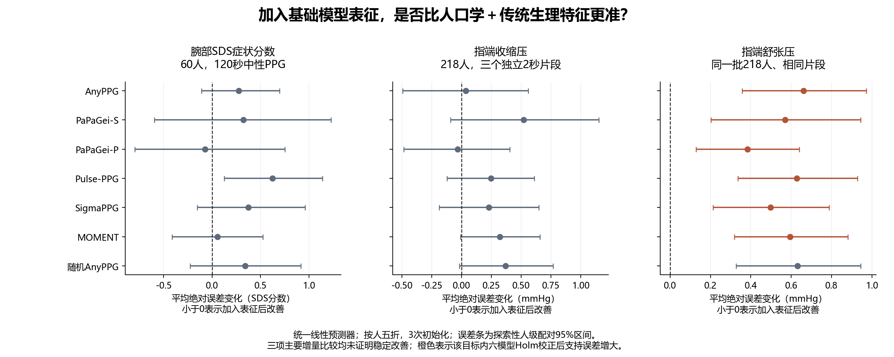

# PPG基础模型正式扩展评测

2026-11-05，Asia/Shanghai。用户批准的四步正式评测已完成；本报告承接[小样本方案](ppg_expansion_plan_and_pilot.md)。所有预训练编码器保持不变，只拟合下游小预测器和监督CNN；未开展基础模型预训练、编码器微调或恢复历史全套队列。

> **2026-11-06解释修订**：[SDS与去噪原因分析](ppg_advantage_limitations_and_next_steps.md)确认，合成去噪的EMBC参考在去直流前重采样，默认零延拓产生边界瞬变，影响噪声尺度及后续带通；另有基模与CNN输入信息不一致、目标频带不匹配的问题。下图的**EMBC/EPFL去噪两面板及本报告去噪排名仅保留为历史结果，须修正协议后重评，暂不用于判断基模去噪能力**。旧文件、指标与95份审计证据未覆盖；可复算不等于科学设定无缺陷。本轮没有新训练，其余任务未因这一去噪专用流程发现而更改数值。

## 目前证据说明什么

六模型统一评测没有得到“PPG基础模型普遍超过传统方法和小型CNN”的结论。更具体的结果是：AnyPPG在部分少标签心率场景有价值；AnyPPG与MOMENT在WESAD三类实验状态上优于本次传统特征对照；三个时序基模的伪影检测优于手工特征，但CNN均值仍更高。跨数据集心率、手机质量、腕部SDS健康信息增量和临床辅助任务的证据更弱，部分模型反而变差。

这并不等于模型没有生理信息，也不能根据一个小预测器的失败判定模型能力上限。它意味着：在目前数据、观察时长、冻结特征和简单预测器的组合下，尚不能成立更强的推广结论。基模优势是被检验的假设，不是评测必须得到的答案。



[矢量图](results/ppg_formal_expansion/formal_overview.svg) · [图中数值与来源哈希](results/ppg_formal_expansion/formal_overview_values.json)。各面板保留原始量纲；图上的误差条是人级探索性95%区间。灰色横杠表示没有评测，不表示零分。主图选用各任务在运行前指定的预测器，未从测试结果中挑选每个模型的最佳接法。

## 模型、数据与任务覆盖

六个预训练模型是AnyPPG、PaPaGei-S、PaPaGei-P、Pulse-PPG、SigmaPPG、MOMENT-1-small。前五个为PPG专用模型，MOMENT是通用时序对照；不能统称六个PPG专用基模。选择依据和原论文讨论见[模型范围分析](ppg_model_scope_and_literature_analysis.md)。

| 任务 | 实际数据与观察量 | 模型与对照 | 证据适用范围 |
| :--- | :--- | :--- | :--- |
| HR、少标签、跨数据集 | DaLiA 15人64,697窗；Wild 16人94,744窗，均8秒 | 六模型；三种预测器；随机Any；CNN；Welch/Elgendi式；训练均值 | 腕部窗口HR，不是逐搏精度 |
| PPG质量 | 完整BUT 50人3,888条10秒记录 | 六模型；统一线性/MLP；随机Any；CNN；传统SQI；类别比例 | 手机红通道、HR可读性，不是腕部形态质量 |
| 实验状态/刺激类别 | WESAD 15人3,274窗；ECSMP 60人9,651窗 | 同上，所有方法观察相同10秒 | 三类实验状态/六类视频刺激，不是临床压力或情绪诊断 |
| **SDS健康信息增量，主任务** | ECSMP 60人；每人连续120秒中性腕部PPG | 六模型；人口学、传统特征、表征及融合；随机Any、CNN、训练均值 | 自评症状分数；18–28岁，非抑郁症诊断 |
| 血压增量，补充 | PPG-BP 218人；每人三条独立采集记录的前2秒 | 同上；收缩压、舒张压 | 指端、袖带标签，不是腕部血压测量 |
| 年龄，辅助 | 同一PPG-BP 218人 | 六模型、随机Any、传统特征、均值；线性/MLP | 实际年龄预测，不是血管年龄；输入协变量移除年龄 |
| 呼吸率 | BIDMC 46名真实患者，735个32秒片段 | 六模型、随机Any、CNN、手工特征、调制频谱、均值 | 双人工标注一致范围内；临床辅助域 |
| 连续血压 | PulseDB现有MIMIC子集；100训练/20验证/42测试患者，每人50片段 | 六模型、随机Any、CNN、手工特征、均值 | 8,100段；官方Train/CalFree患者隔离，非全库或AAMI验证 |
| 人工逐搏、PRV | EMBC21 7人105条采集记录 | Any、PaPaGei-S/P、随机Any、CNN、MSPTDfast风格算法 | 单专家PPG起始点；60秒PRV多数静息，非ECG HRV |
| 逐点伪影 | DaLiA/SEGADE 15人4,305条标注 | Any、PaPaGei-S/P、随机Any、CNN、手工局部特征 | 每条固定中央8秒输入、中央6秒评分，覆盖原标注时长20% |
| 合成去噪 | EMBC21 7人504合成对；EPFL 1人340噪声副本、3,060窗 | Any、PaPaGei-S、随机Any、CNN、固定带通、原始带噪 | 已知合成参考；不能代表真实运动下的干净波形恢复 |

逐点任务只接入已验证时序特征接口的模型。没有把全局平均特征复制成逐点序列，也没有把其他模型留空解释为它们表现差。新增EPFL、SEGADE、BIDMC人工呼吸及身份修正资料在此前流程阶段已补齐，本轮完成正式使用；未另购数据或启动云服务器。

## “统一预测器”和随机对照具体做了什么

**预测器**是把基模输出的特征转成心率、分数或类别的小模型。HR保留原始维度Ridge线性预测器，同时增加“训练集降到16维后使用Ridge”和“同样16维后接16个隐藏单元的小MLP”。MLP有289个参数。健康任务因训练人数更少，固定8维；人口学、传统特征和融合输入补零到相同输入宽度，保证同任务各组预测器结构一致。补零的是特征向量，不是伪造PPG波形。

降维、标准化、缺失处理只由训练人拟合；选择正则化、轮数和阈值只用验证人。测试人从不参与拟合或选参。PCA本身也是拟合步骤，因此不能说整套流程只学了17或289个数。压缩到16维可能损失有效信息，故原始维度结果同时保留。

随机Any对照使用相同网络架构、相同输入预处理和相同小预测器，但不加载预训练权重，三个种子分别初始化后冻结。它回答“预训练得到的特征是否比随机特征有价值”。小型CNN则从随机初始化接受任务监督训练，回答“简单任务专用模型能做到什么”。二者不能相互替代。随机消融目前只覆盖Any架构，不能据此对其余五个模型作预训练因果归因。

每个任务保留三个初始化种子。回归和逐搏通常先在每个人内部平均种子，再按人汇总；分类为每人总权重相等的合并AUROC或混淆矩阵指标，先分别计算每个种子再平均。所有区间以整个人为重抽样单位。多窗、三种子和340个合成副本都没有当成独立受试者。主要比较在各任务家族内使用Holm多重比较校正；没有作所有任务的全局校正。固定划分、少量受试者及交叉验证训练集重叠使推断仍属探索性，不能把这些p值当大规模独立确认性研究。

统一预测器没有消除全部实现差别：各模型保留原生采样率、滤波与归一化。Pulse-PPG在相应数据中使用整条未标注采集记录的统计量归一化；因此预测用波形窗口相同，不等于所有方法获得完全相同的时间上下文，也不代表实时流式部署。结果同时受预训练、架构、预处理和特征压缩影响。

不再使用“全预算”等简称。DaLiA常规评测每折9人训练、3人验证、3人测试；Wild为9或10人训练、3人验证、4或3人测试。少标签分别是2训练＋1验证、4训练＋2验证，每人全部有效片段可用，**不等于只标注几分钟**。跨数据集为12名DaLiA训练、3名DaLiA验证，16名Wild测试。

## 心率：预训练有局部价值，跨数据集优势没有成立

下表为人均MAE，单位bpm，越低越好。两种接法都完整报告，不能在每个单元格中选较小值拼成一个方法。

| 方法 | DaLiA原维线性 | Wild原维线性 | DaLiA→Wild原维线性 | DaLiA统一MLP | Wild统一MLP | DaLiA→Wild统一MLP |
| :--- | ---: | ---: | ---: | ---: | ---: | ---: |
| AnyPPG | 7.88 | 11.18 | 17.72 | 8.79 | 11.20 | 18.84 |
| PaPaGei-S | 14.43 | 13.62 | 19.30 | 17.08 | 13.93 | 17.69 |
| PaPaGei-P | 12.41 | 13.05 | 21.47 | 15.09 | 13.66 | 17.67 |
| Pulse-PPG | 10.49 | 12.02 | 18.87 | 12.28 | 12.49 | 21.15 |
| SigmaPPG | 11.84 | 12.29 | 14.65 | 15.47 | 13.84 | 15.37 |
| MOMENT | 8.63 | 12.63 | 16.00 | 9.68 | 13.51 | 18.52 |
| 随机Any | 10.95 | 12.25 | 20.91 | 12.49 | 13.00 | 19.78 |
| CNN，同一结果重复展示便于比较 | 7.24 | 11.50 | 15.87 | 7.24 | 11.50 | 15.87 |
| Elgendi式，同一结果 | 10.45 | 16.46 | 16.46 | 10.45 | 16.46 | 16.46 |
| Welch，同一结果 | 17.40 | 23.31 | 23.31 | 17.40 | 23.31 | 23.31 |

统一MLP下，Wild仅2训练＋1验证时，Any相对CNN减少**2.64 bpm**，配对95%区间[1.47,4.02]，场景内Holm校正p=0.00146；DaLiA相同人数时改善0.80 bpm，区间跨零。原维线性在DaLiA少标签下较好的旧结果仍成立，但不能自动转移为新预测器的结论。

Any预训练对比随机冻结Any，在六个同数据集场景中均有校正后的改善证据；跨数据集差异则没有通过校正。Sigma在迁移原维线性中均值14.65低于CNN15.87，但配对差的区间跨零，不能据此宣布稳定迁移优势。

跨数据集下降的既有诊断保持有效：[第二阶段报告](ppg_phase2_results.md)。低HR和低ACC窗口贡献显著，不能简单归咎于剧烈运动，也未证明某个硬件差异是因果原因。当前模型对训练人群、设备与活动分布的依赖仍是主要问题。传统HR在Wild并非全覆盖，Elgendi式覆盖99.13%、Welch99.36%；其MAE是有输出窗口上的条件误差，不能忽略拒识。

完整[HR表](results/ppg_formal_expansion/hr/summary.csv)、[配对结果](results/ppg_formal_expansion/hr/paired_primary.csv)、[审计](results/ppg_formal_expansion/hr/audit.json)。



## 主任务SDS：未检出超出传统信息的稳定增量

ECSMP每人取连续120秒中性腕部BVP，切成15个非重叠8秒片段后聚合，最终每人只产生一个SDS分数预测。每折36人训练、12人验证、12人测试。人口学包含年龄与性别；传统特征包含HR/PRV、波形及质量统计。这里的传统PRV没有独立ECG测量验证，只是预测用特征。

| 输入，统一线性预测器 | SDS MAE，分 |
| :--- | ---: |
| 人口学 | 7.18 |
| 人口学＋传统特征，主要对照 | 6.92 |
| 上述对照＋AnyPPG | 7.19 |
| 上述对照＋PaPaGei-S | 7.24 |
| 上述对照＋PaPaGei-P | 6.84 |
| 上述对照＋Pulse-PPG | 7.54 |
| 上述对照＋SigmaPPG | 7.29 |
| 上述对照＋MOMENT | 6.97 |
| CNN单独 / 加入对照特征 | 6.98 / 7.21 |
| 训练人SDS均值 | 7.07 |

PaPaGei-P的均值最低，但比主要对照只减少0.075分，配对差区间为[−0.797,+0.752]分，Holm p=1。**“数值更低”在这里不足以证明健康信息增量。** 60名18–28岁参与者、有限SDS范围和仅2分钟观察都限制了推断；不能解释为PPG对心理健康永远没有信息。



PPG-BP的主要对照收缩压/舒张压MAE为13.30/7.94 mmHg。六模型融合未显示稳定收缩压改善；舒张压融合均比同一主要对照更差，差约0.38–0.66 mmHg，任务内校正后仍有证据。这里包含独立表格HR协变量；所有融合组获得相同协变量，因此是在问“表征的额外贡献”，不能直接当作纯PPG独立估压能力。每条仅2秒的片段无法组成连续PRV，三条采集记录从不拼接制造节律。

年龄辅助任务共705份结果通过审计，严格从全部输入协变量删除年龄，保留性别、BMI及传统PPG特征。主要对照MAE10.05岁；加入Pulse-PPG为9.88岁，加入Any为10.66岁，其余融合约10.11–10.59岁。这里仅作辅助探索，没有新增已确认的健康增量结论；预测的是实际年龄，不是血管年龄。[年龄完整表](results/ppg_formal_expansion/health/PPG-BP-age_summary.csv)

完整[SDS表](results/ppg_formal_expansion/health/ECSMP_summary.csv)、[血压表](results/ppg_formal_expansion/health/PPG-BP_summary.csv)、[配对增量](results/ppg_formal_expansion/health/ECSMP_comparisons.json)。

## 分类与临床辅助：有收益的任务和无收益的任务都保留

BUT质量分类，统一16维线性头：Any AUROC **0.872**，传统SQI **0.851**，随机Any **0.849**，CNN **0.852**。Any对传统和随机Any的配对区间都跨零；不能凭最高均值宣布稳定优势。本次CNN观察与所有表征一致，使用两个8秒视图覆盖整个10秒，和第二阶段旧CNN的设置不同，因此新旧CNN数字不应无解释地混用。

WESAD三类状态，Any平衡准确率**0.553**、MOMENT **0.564**、传统特征**0.497**；两者相对传统特征分别改善0.055、0.067，数据集内Holm校正p约0.0075、0.0060。Any对随机Any改善约0.062，校正后亦有证据。这是实验条件识别结果，不能升级为临床压力诊断。ECSMP六类刺激任务大多数方法接近随机机会水平1/6，主比较均无稳定优势。

BIDMC按**46名真实患者**分组，修正旧53个采集记录编号被当作53人导致的泄漏。735个32秒窗口来自双人工呼吸标注一致范围；6个标注不足和54个分歧超过2次/分钟窗口排除。统一MLP的Any呼吸率MAE2.50次/分钟、CNN2.54、手工特征2.50，而训练患者均值2.39；没有证据说明基模超过这个简单对照。固定调制频谱融合为3.86，单分量结果也全部公开，未从测试集挑最好的传统算法。把四个8秒表征平均用于32秒呼吸任务可能丢失跨片段慢调制，故本结果只评价当前轻量接法。

PulseDB利用现有文件完成正式按需映射与预测：训练/验证来自官方Train，测试来自CalFree，患者互斥。固定抽样排除AAMI患者和小样本阶段已看过的4名测试患者；现有可读MIMIC文件支持42名新测试患者，未声称覆盖完整VitalDB或AAMI。Any收缩压/舒张压MAE16.75/9.21 mmHg，CNN17.41/10.07，手工特征同头15.87/8.84。主要比较校正后没有稳定基模优势。Any的预训练含PulseDB，其他模型亦可能与源队列重合，**患者级下游隔离不等于预训练数据绝无交叉**。

[分类汇总与独立审计](results/ppg_formal_expansion/classification/) · [临床汇总](results/ppg_formal_expansion/clinical/summary.csv) · [患者/参考审计](results/ppg_formal_expansion/clinical/clinical_reference_audit.json)。

## 逐搏、PRV、伪影与去噪

逐搏按7人留一测试、另1人验证、5人训练；相同人工起始点参考；三个种子；新增PaPaGei-S/P与同架构随机Any。Any时序小头26,737参数，PaPaGei时序小头27,367参数，CNN17,353参数，容量接近但并非相同架构。协议在拟合之前固定。

| 方法 | 逐搏F1，±50ms ↑ | 60秒RMSSD误差，ms ↓ | 60秒SDPP误差，ms ↓ |
| :--- | ---: | ---: | ---: |
| AnyPPG | 0.97885 | 20.52 | 10.36 |
| PaPaGei-S | 0.96903 | 28.53 | 18.09 |
| PaPaGei-P | 0.96622 | 30.34 | 20.32 |
| 随机Any | 0.96780 | 31.40 | 20.58 |
| CNN | 0.97613 | 45.08 | 28.44 |
| 传统MSPTDfast风格 | 0.96618 | 38.32 | 21.53 |

Any相对CNN的RMSSD误差减少24.56ms，未校正配对区间为[1.83,60.42]ms；相对随机Any减少10.88ms，区间[3.81,19.44]ms。方向有希望，但**7人的8个主要比较全部未通过Holm校正**。七人双侧精确符号翻转检验最小p=0.015625，八比较首项校正后最低0.125；不能通过把窗当独立样本来制造显著性，也不能只引用未校正区间宣称确证。

60秒参考仍为175窗，其中159窗静息；蹲起仅1人2窗、踏步4人14窗。300秒仅2人4窗，不构成标准5分钟人群验证。上述是PPG脉率变异性与单专家PPG参考的一致性，不能当成ECG HRV准确度。新增多种子结果与旧单种子数值有差别，旧报告保留。[逐搏完整表](results/ppg_formal_expansion/onsets/summary.csv) · [配对比较](results/ppg_formal_expansion/onsets/paired.csv) · [独立事件与PRV复算](results/ppg_formal_expansion/onsets/independent_metric_audit.json)

SEGADE全部4,305条公开波形已匹配回原始DaLiA受试者与时间，每条1,920点重建最大误差为零；先完成身份核验，再按人分折。每条固定取中央8秒输入、中央6秒评分，避免边界影响；7.175小时评分覆盖，不把它称全量标注时间评测。

伪影检测人均F1：**Any 0.862、PaPaGei-S 0.853、PaPaGei-P 0.850、随机Any 0.849、CNN 0.869、手工特征0.822**。三个预训练模型相对手工特征的改善约0.040/0.031/0.028，四比较内Holm p均0.000244；Any相对随机Any改善0.013，配对区间[0.005,0.022]，Holm p=0.00934。这支持本协议下预训练特征具有伪影识别价值，但没有证明超过小型CNN。输出为伪影标签，不是恢复后的干净波形，不能把检测收益当去噪收益。[伪影结果](results/ppg_formal_expansion/artifact/summary.csv) · [配对比较](results/ppg_formal_expansion/artifact/paired.csv)

合成去噪对EMBC21静息参考添加白噪声、基线漂移和突发尖峰，−5/5/15 dB三个等级；每人24个非重叠片段，严格按人划分。静息原波形也不保证真正无噪，故叫“合成参考”。所有方法相同噪声，归一化只用带噪输入，不用干净参考求增益或对齐。固定带通加学习残差是一种输出设计，基模不会自动天然输出干净PPG。EPFL只作外部测试，不用它选参数；340副本共享一个原始人，不能产生340人的人群置信区间。

| 去噪方法 | EMBC21相对波形误差NRMSE ↓ | EMBC21平均SNR增益，dB ↑ | EPFL外部NRMSE ↓ |
| :--- | ---: | ---: | ---: |
| 原始带噪 | 1.683 | 0.00 | 1.065 |
| 固定带通滤波 | 1.279 | −1.05 | 0.239 |
| AnyPPG | 1.016 | 0.61 | 0.730 |
| PaPaGei-S | 0.979 | 0.91 | 0.862 |
| 随机Any | 0.943 | 1.12 | 0.751 |
| CNN | 0.812 | 3.20 | 1.105 |

结果没有显示预训练去噪优势：EMBC21下CNN误差最低，随机Any也低于预训练Any；EPFL外部测试中固定滤波最好。四项预先指定的NRMSE配对比较经Holm校正均为0.0625，仅7人的结果不足以作确定性宣称。NRMSE下降也未保证HR提取改善：CNN的固定Welch HR误差8.35 bpm，高于带噪输入6.89 bpm。原波形的慢变化并不保证都是噪声，波形误差、SNR和生理任务必须共同看，不能以平滑程度定义成功。[完整去噪报告与分层结果](results/ppg_formal_expansion/denoising/README.md)

## 为什么正式移除SpO₂

你的质疑切中任务定义问题。“预测监护仪血氧”只是**猜测另一个设备给出的数字**；“血氧测量验证”则要求证明输入确实支持氧饱和度测量，并与适当独立参考比较。这两件事不能用同一个低MAE替代。

常规脉搏血氧仪利用红光与红外光的不同吸收特性，计算两路脉动/直流分量的比值，再经过标定。只有一路导出的归一化Pleth波形，没有第二波长和直流信息，就不能直接复用这个测量原理。[Analog Devices技术说明](https://www.analog.com/en/resources/technical-articles/guidelines-for-spo2-measurement--maxim-integrated.html)

[BIDMC官方数据](https://physionet.org/content/bidmc/1.0.0/)提供一个导出的Pleth波形和监护仪SpO₂数值，没有本任务需要的同步原始红光/红外光两路及标定信息。也不能武断说这个导出通道就是已知波长的原始单波长信号。监护仪SpO₂自身是设备估计，不等于动脉血共氧测定参考；正式脉搏血氧仪准确性研究的独立参考要求见[FDA说明](https://www.fda.gov/regulatory-information/search-fda-guidance-documents/pulse-oximeters-premarket-notification-submissions-510ks-guidance-industry-and-food-and-drug)。本PoC无需做认证工程，但必须正确命名任务。

单路波形与血氧标签存在统计相关性是可能的，模型也可能借助人群、心率、血管状态或设备背景间接预测；这种可能性不等于已被本项目证明，更不保证低氧时可靠。本机BIDMC有效1Hz血氧标签中位数98%，约79.96%在95%–100%，低于90%的仅3.80%，来自3名患者。仅预测训练患者均值，诊断性按人五折MAE就约2.46个百分点；这与旧10秒任务口径不同，不直接比数值，但说明低MAE可以缺少测氧意义。

因此，**本轮将SpO₂移出正式任务及综合图，保留历史复现记录**。它既不是当前最清晰的单路PPG生理任务，也不足以支撑手表血氧测量结论。呼吸率、逐搏、PRV与有明确参考的血压更适合当前PoC。[本机血氧分布审计](results/ppg_formal_expansion/clinical/spo2_scope_audit.json)

## 与Apple、Google工作的关系

[Apple ICLR 2024原始PPG研究](https://arxiv.org/html/2312.05409v2)最有启发的是人级健康信息与人口学/心率统计对照，而不是证明每一个信号测量任务都更好。本项目采用相近的研究问题，并更直接检验“人口学＋传统特征”基础上加入表征的增量；这不是复现Apple的私有模型、数据或疾病任务。本次SDS阴性结果也不否定Apple的结果，两者人群、标签、观察量和预训练规模均不同。

[Google LSM](https://arxiv.org/html/2410.13638v1)、[SensorFM](https://arxiv.org/html/2605.22759v1)以及[Apple WBM](https://arxiv.org/html/2507.00191v1)主要使用分钟/小时级衍生指标和更长时间上下文。它们证明的健康表征能力不能直接当作125Hz原始PPG逐搏、去噪能力的证据。本次借鉴其多任务、少标签、统一读出和清楚标注不确定性的展示思路，采用原始量纲分面图，没有把不同任务压成雷达总分。

调研仓最新核查到[`348a1736457050e611508fa4a324959590bb22fc`](https://github.com/tujy859/Wearable-Physiological-Foundation-Models/tree/348a1736457050e611508fa4a324959590bb22fc)。相较小样本阶段记录版本，相关模型/数据专题没有变化，新增主要为网站和文档样式；实验继续使用已固定上游版本和权重哈希。

## 复现与后续方向

共享结果保存在[`docs/results/ppg_formal_expansion/`](results/ppg_formal_expansion/)，包含协议、按人统计、配对比较、图和审计。原始波形、表征、逐窗预测及下游权重在忽略的`.local/ppg-formal-expansion/`，不随Git分发。已有各阶段结果未覆盖，新增协议单独保存。

| 检查范围 | 完成与核查 |
| :--- | :--- |
| HR | 1,953份读出结果，含372份经哈希核验的旧线性复用；全部保存头重放，6次独立sklearn拟合 |
| 三数据集分类 | 765份；独立重算全部指标，6次独立拟合；原始WESAD/ECSMP全部窗口与BUT标签/抽样物理波形复核 |
| SDS、PPG-BP与年龄 | 2,205＋705份；按人聚合、预测输入、原始标签和独立Ridge重拟合通过 |
| 临床辅助 | 606份；BIDMC真实患者和人工参考复核，PulseDB 8,100片段逐条源映射重读 |
| 逐搏/PRV | 1,890个记录评分输出，1,680份唯一预测文件；92,962标量独立复算最大差4.55×10⁻¹³ |
| 逐点伪影 | 105份；75神经头CPU重放概率最大差2.98×10⁻⁵、阈值决策完全相同；15个CNN用原GPU重放差0；15传统头独立重新选参拟合 |
| 合成去噪 | 84头；257,040条EPFL外部窗口预测；3,564个原始配对重建差0，840组指标数组独立复算 |
| 单元与环境 | 本机241项通过；模拟不含可选PPG-Bench的干净CPU环境237项通过，其中1个旧集成模块按设计跳过 |

这些是不同口径的产物数量，不相加当成独立科学实验或独立受试者。更多核查范围及文件哈希见[汇总验证](results/ppg_formal_expansion/verification.json)。用户指出的旧GitHub检查`42027216305`属于`7cb3948`的可选依赖导入错误，已在`5b9faf4`修复；[后续四组检查](https://github.com/tujy859/Watch_LSM/actions/runs/42035847292)已通过。旧记录不会变绿，新正式提交的状态以其自身检查为准。

运行入口按任务分开，避免创建复杂队列：`ppg_formal_hr.py`的register/features/heads；`ppg_formal_classification.py`的prepare/features/run；`ppg_formal_health.py`的prepare/features/fit与单独CNN入口；`prepare_ppg_formal_clinical.py`及`ppg_formal_clinical.py`；`ppg_formal_onsets.py`；`prepare_ppg_formal_artifact.py`及`ppg_formal_artifact.py`；`ppg_formal_denoising.py`的prepare/features/fit/external。各自默认指向独立正式目录，完整参数用`--help`查看；先恢复数据清单和固定模型环境，不在缺少原始参考时直接重跑。

```powershell
# 仅重画综合图，无需原始数据、模型权重或GPU
.venv/Scripts/python.exe scripts/plot_ppg_formal_overview.py
.venv/Scripts/python.exe scripts/plot_ppg_health_increment.py

# CPU单元检查；模型推理评测使用已有独立ppg-bench环境
.venv/Scripts/python.exe -m unittest discover -s tests
```

下一步更值得投入的是增加独立腕部人群、较长连续观察和可解释的健康标签，而不是以现有小队列重复调参追求胜出。若继续研究跨数据集HR，应保留设备/活动/心率分层，并在新测试数据上验证预先选定的适配方案。去噪需要更多真实配对或可信参考；心理健康信息需要更大的受试者数量和独立验证。当前没有依据启动基模预训练来“保证优于传统”。
