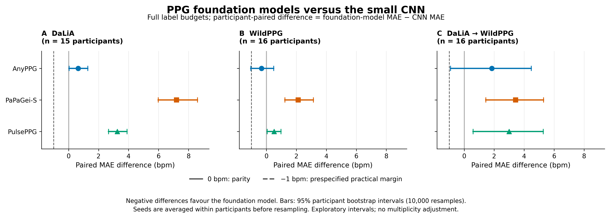
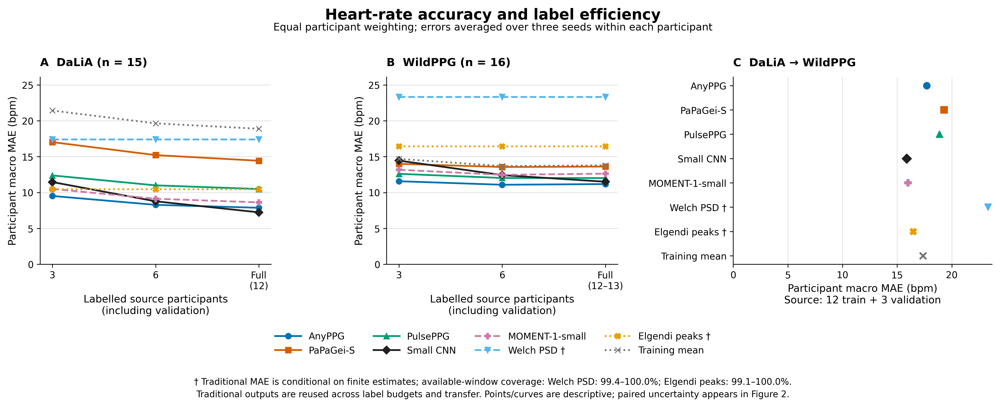
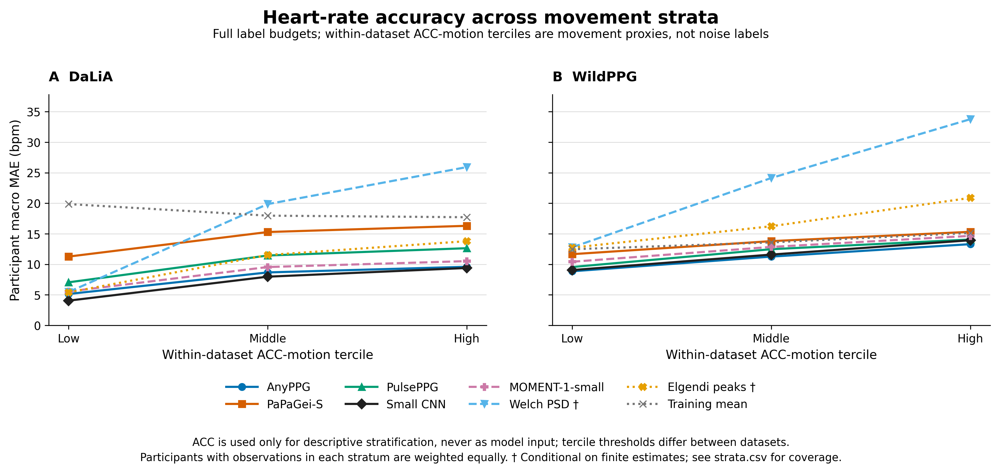

# 腕部PPG心率评测 第一阶段结果

术语补充：此前“全预算”表示留出测试人后，使用全部可用训练/验证标签；DaLiA每折9人训练/3人验证，Wild为9或10人训练/3人验证。“3人预算”是2人训练/1人验证，不是3人全部用于拟合。新图直接标人数。后续[正式扩展结果](ppg_formal_expansion_results.md)已补六模型、统一预测器和随机对照，本报告实验数值不变。

2026-11-04。**第一阶段已完成。AnyPPG的主要收益出现在少标签条件；本次证据不支持PPG基础模型在所有心率场景普遍更强。** 全标签时小型CNN具有竞争力，DaLiA到WildPPG迁移没有显示PPG基模相对强对照的稳定优势。

完成93组受试者划分、372次冻结表征Ridge拟合、93次小型CNN拟合、93份训练均值对照，以及两数据各两种传统算法，共558组标签相关结果和4份传统输出。全部通过独立结果审计。没有开展基础模型预训练或编码器微调。

11月5日补充解读：少标签收益并非只出现在AnyPPG；Pulse-PPG在WildPPG的3人预算下也优于CNN，配对MAE减少1.84 bpm，探索性95%区间[0.64, 3.16]。AnyPPG在两份数据上的方向更一致。完整模型范围与论文对照见[选型及结果分析](ppg_model_scope_and_literature_analysis.md)，原始实验数值与协议不变。

## 主结果

下表为全标签预算的**受试者等权平均MAE，单位bpm，越低越好**。三列结果包括两份数据各自的受试者隔离测试，以及只在DaLiA拟合后迁移到WildPPG。粗体仅表示本表最低点估计。

| 方法 | DaLiA域内 | WildPPG域内 | DaLiA → WildPPG |
| :--- | ---: | ---: | ---: |
| AnyPPG + Ridge | 7.88 | **11.18** | 17.72 |
| PaPaGei-S + Ridge | 14.43 | 13.62 | 19.30 |
| PulsePPG + Ridge | 10.49 | 12.02 | 18.87 |
| MOMENT-1-small + Ridge | 8.63 | 12.63 | 16.00 |
| 小型监督CNN | **7.24** | 11.50 | **15.87** |
| Elgendi式峰检测 | 10.45 | 16.46† | 16.46† |
| Welch频谱 | 17.40 | 23.31† | 23.31† |
| 训练均值常数 | 18.89 | 13.79 | 17.36 |

† WildPPG上Elgendi和Welch分别覆盖99.13%、99.36%的有效参考窗口，表中是成功输出窗口上的条件MAE；其他方法覆盖100%，DaLiA两种传统算法也覆盖100%。传统方法没有拟合，因此域内与迁移列复用同一输出。配对差值已另按共同有效窗口计算，详见[完整主表](results/ppg_hr_poc/summary.csv)与[配对结果](results/ppg_hr_poc/paired.csv)。

AnyPPG相对CNN的全预算差值为：DaLiA **+0.64 [0.03, 1.28]**，WildPPG **−0.32 [−1.04, 0.48]**，跨数据集 **+1.84 [−0.92, 4.47]** bpm。括号为探索性95%受试者bootstrap区间，负值有利于AnyPPG。WildPPG的较低点估计尚不能证明稳定优势；跨数据集区间也没有支持其优于CNN。PaPaGei-S与PulsePPG在本8秒冻结线性接口下均未超过CNN。



## 少标签与运动分层

总标签预算包含验证人。此表保留与CNN的对照，所有模型的完整曲线见图与CSV。

| 数据 | 总标签人数 | AnyPPG | CNN | AnyPPG − CNN及95%区间 |
| :--- | :--- | ---: | ---: | :--- |
| DaLiA | 3 | 9.52 | 11.46 | −1.94 [−3.43, −0.50] |
| DaLiA | 6 | 8.28 | 8.78 | −0.50 [−2.13, 0.79] |
| DaLiA | 全部12 | 7.88 | 7.24 | +0.64 [0.03, 1.28] |
| WildPPG | 3 | 11.58 | 14.45 | −2.87 [−4.30, −1.65] |
| WildPPG | 6 | 11.08 | 12.43 | −1.35 [−2.13, −0.63] |
| WildPPG | 全部12或13 | 11.18 | 11.50 | −0.32 [−1.04, 0.48] |

**少标签是本轮更有支持的收益方向。** 两数据3人预算下AnyPPG均优于CNN的点估计，探索性区间不跨0；WildPPG这项比较的区间还整体超过预设1 bpm收益参考线。随着标签人数增加，CNN明显追近。不能将这种少标签收益推广到其他基模、所有标签预算或跨数据集情形。



DaLiA补回的839窗中，AnyPPG为9.18、CNN为8.91、Elgendi为11.74 bpm；原流程保留窗口上对应为7.86、7.22、10.43 bpm。包含新增窗后，主比较方向未改变。运动强度分层见下图：更高ACC分位通常伴随更大HR误差，且基础模型与CNN同样存在退化，不能仅凭平均HR误差宣称学会了运动伪影去除。[逐层结果与覆盖率](results/ppg_hr_poc/strata.csv)、[逐人结果](results/ppg_hr_poc/per_subject.csv)。



下一步建议保留AnyPPG、CNN与传统峰检测作为固定对照，优先建立逐搏/PRV参考，并对跨设备误差做针对性检查；当前结果不足以把重新预训练作为已证实必要的下一步。后续若要将增益归因于预训练，再加入同架构随机初始化消融及预先限定的任务头适配。

## 数据与参考标签

| 数据 | 人数 | 窗口与步长 | 本次评价范围 | 参考 |
| :--- | ---: | :--- | :--- | :--- |
| DaLiA | 15 | 8秒，步长2秒 | 64,697窗，包含原流程排除的839窗 | 发布数据中的同步ECG心率标签 |
| WildPPG | 16 | 8秒，步长8秒 | 97,554个候选窗中的94,744个有效参考窗 | 官方函数从胸骨ECG重新计算的HR |

两份原始数据及模型权重均已齐备，本轮无需新增数据下载。所有方法只输入同一物理时段的腕部单通道PPG；ECG只作参考，ACC只用于描述性分层。WildPPG使用腕部绿光128 Hz原始通道。[DaLiA数据](https://archive.ics.uci.edu/dataset/495/ppg+dalia)、[WildPPG数据与通道说明](https://siplab.org/projects/WildPPG)。

**DaLiA补回困难窗口。** 原PPG-Bench预处理保留63,858窗；本次补回831个跨活动窗口和8个低振幅窗口。原窗口在50/64/125 Hz下的波形、时间与标签已逐行核对。新增窗单独报告；“跨活动”本身不等同于有伪影标注。

**WildPPG参考纠正。** 固定PPG-Bench移植实现遗漏官方检测器在超过100个信号峰后调整阈值权重的分支，并改变漏搏检测RR阈值的取整顺序。本次直接加载发布包内五个原始函数，另与当前[官方源码](https://github.com/eth-siplab/WildPPG/blob/main/src/supervised_baselines/data_preprocessing.py)逐函数语法树核对一致；未修改官方算法。相对旧预处理，新增1,335个有效参考窗、失去552个，共同有效的93,409窗中有3,640个HR值改变。旧数据与结果保留在原路径，新PoC使用独立参考及样本视图。

WildPPG参考经过官方ECG间期质量筛选，2,810个候选窗没有有效参考，不进入误差计算。这是自动ECG参考，并非人工裁决的逐搏真值；结果仅适用于参考可用窗口。传统方法的输出覆盖率也以这一集合为分母，不能直接视为全天可用率。

## 固定评测协议

**同数据集内评测。** 每份数据固定一套受试者五折，外层划分种子20261104；种子42/43/44改变嵌套标签子集及CNN初始化，外层测试人保持一致。训练、验证和测试受试者严格隔离，所有方法共享划分。重叠窗口不会跨受试者划分。

| 总标注人数预算 | 用于拟合 | 用于选择参数或训练轮数 |
| :--- | :--- | :--- |
| 3人 | 2人 | 1人 |
| 6人 | 4人 | 2人 |
| 全部外层可用人 | DaLiA 9人；WildPPG 9或10人 | 3人 |

较小预算的训练集与验证集分别嵌套于较大预算，验证人计入标签成本。每个人的所有有效窗口可用；这是**少受试者标签实验**，不等同于只标注几分钟。实际人名、窗口数及划分保存在[协议文件](results/ppg_hr_poc/protocol.json)和本机逐次结果中。

**跨数据集评测。** 每个种子使用DaLiA的12人拟合、3人验证，然后对WildPPG全部16人测试。超参数和CNN训练轮数均只依据DaLiA验证集；没有目标域标签适配。该实验与WildPPG域内重新拟合预测头分开报告。

**拟合与对照。** 四个公开模型均冻结编码器，提取512维表征；训练受试者均衡加权的标准化与Ridge，alpha固定候选为0.01/0.1/1/10/100/1000，以验证受试者平均MAE选择。选参后不合并训练与验证重新拟合。小型CNN为27,065参数、四层卷积，64 Hz输入、逐窗标准化；固定Adam 1e-3、FP32、batch 1024、最多20轮、耐心5轮，以受试者均衡L1训练，保存验证集最佳轮次。不基于测试结果增加训练或调参。

| 对象 | 输入采样率与处理 | 标签使用 |
| :--- | :--- | :--- |
| AnyPPG | 125 Hz，固定上游原生滤波及逐窗归一化 | 只拟合Ridge |
| PaPaGei-S | 125 Hz，固定上游原生滤波、平滑及逐窗归一化 | 只拟合Ridge |
| PulsePPG | 50 Hz，上游原生滤波及整名受试者采集记录均值/标准差 | 只拟合Ridge |
| MOMENT-1-small | 64 Hz，原生embedding接口与模型自身归一化 | 只拟合Ridge |
| SmallCNN | 64 Hz，逐窗标准化 | 从随机初始化训练小型任务网络 |
| Welch | 64 Hz，0.5–4 Hz滤波，0.5–3.5 Hz主频搜索 | 无标签 |
| Elgendi式峰检测 | 64 Hz，0.5–8 Hz滤波、双移动均值阈值，60/中位峰间期 | 无标签 |
| TrainMean | 训练受试者等权平均HR常数 | 只使用拟合人标签 |

传统方法均独立处理8秒窗口，不用ACC或相邻窗跟踪，不裁剪预测HR；无法输出时保留NaN并报告覆盖率。峰检测是基于[Elgendi等2013算法IV](https://doi.org/10.1371/journal.pone.0076585)的独立实现，逐窗边界和中位间期汇总是本PoC设定，不宣称复现其连续信号实验。它们是固定PPG-only对照，不代表所有传统方法或ACC辅助算法的最佳水平。

全部处理为离线评测。PulsePPG沿用上游整段、无标签的受试者归一化，测试采集记录的未标注统计量也会使用；因此跨数据集实验是**无目标标签迁移**，不能声称在线因果推理或完全不用目标信号统计量。各模型遵循其固定适配接口；同为8秒输入，不等于分别实现模型最优上下文长度，尤其[PulsePPG预训练使用更长窗口](https://arxiv.org/html/2502.01108v2)。

## 指标与不确定性

主指标单位为bpm：先计算每位受试者、每个种子的窗口MAE，再平均该人的三个种子，最后对受试者等权平均。不是将全部窗口合并，也不是把折或种子当作独立受试者。

传统方法有失败时报告条件MAE与输出覆盖率；正式配对比较只用双方共同有效窗口，再按人平均三个种子的误差差值。对15或16个人做10,000次配对bootstrap，给出探索性95%区间。负差值表示基模误差更低。预先约定1 bpm为本PoC的实际差异参考线，**不是临床标准**。

这些区间条件于固定划分、训练数据和已选模型，不涵盖重新训练、数据集抽样与模型选择的全部不确定性，也没有多重比较校正；不能据此作普遍优越性或临床有效性的结论。种子波动另列于CSV。

运动分层按每份数据内部的ACC去均值RMS三分位划分，不跨数据集共用阈值，不输入模型。它是活动强度代理，**不是运动伪影真值**。DaLiA还按活动标签、原流程保留窗口与新增窗口报告。

## 预训练暴露与结论范围

| 模型 | 论文所述预训练来源与本轮数据的关系 |
| :--- | :--- |
| AnyPPG | MC-MED/PulseDB/MESA/HSP/CFS；预训练列表未列DaLiA/WildPPG，DaLiA已用作原文下游评测 |
| PaPaGei-S | VitalDB/MIMIC-III/MESA；预训练列表未列DaLiA/WildPPG，DaLiA已用作原文下游评测 |
| PulsePPG | 120人野外采集队列；论文预训练说明未列DaLiA/WildPPG |
| MOMENT | 通用Time-series Pile；本轮未完成预训练原始采集记录逐条交叉审计，暴露状态记为未完全核验 |

来源：[AnyPPG](https://arxiv.org/html/2511.01747v4)、[PaPaGei](https://arxiv.org/html/2410.20542v2)、[PulsePPG](https://arxiv.org/html/2502.01108v2)、[MOMENT](https://proceedings.mlr.press/v235/goswami24a.html)。论文未列入不等同于已验证每位受试者从未出现；本次也不是模型开发者未知的全新盲测。当前比较包含架构、预处理与预训练的共同差异，未用同架构随机初始化消融将增益单独归因于预训练。

本阶段只评价8秒窗口HR、标签效率及一次单向设备/人群迁移。不能据此推出逐搏定位、HRV/PRV、真实波形去噪、血压或疾病筛查能力。相关后续任务仍按[评测路线](ppg_evaluation_poc_plan.md)分别建立参考和验证。

## 既有结果复核

旧DaLiA的AnyPPG、PaPaGei-S、PaPaGei-P各25项，共75项通过官方划分独立重建、预测身份、有限值、MAE和训练均值对照重算。受试者平均MAE分别为7.4947、13.9827、11.8520 bpm。WildPPG此前没有已发布HR评测结果。

旧结果使用原63,858窗和五种子五折协议；本次样本、划分、加权、选参与拟合人数量不同，不能把两组数值差异当作模型版本变化。旧结果保持原样，新结果位于独立PoC目录，也不计入原14,625项PPG-Bench全套计划的完成数。

## 复现与产物

环境沿用[PPG-Bench安装说明](ppg_bench_setup.md)，固定上游`2bca102b7be2c0a9816a3872314784d2ef92555b`及现有权重。实际使用Windows、Python 3.12.7、Torch 2.5.1+cu124、GTX 1660 SUPER；表征和CNN均FP32。四个编码器未更新权重。

在项目根目录使用独立benchmark环境依次执行，`python`代表`.local/ppg-bench-venv/Scripts/python.exe`；Linux替换为对应venv路径。绘图使用已安装matplotlib的项目`.venv`。

```text
python scripts/audit_ppg_bench_wrist_hr.py
python scripts/ppg_hr_poc_data.py
python scripts/ppg_hr_wild_reference.py
python scripts/ppg_hr_poc_wild_data.py
python scripts/run_ppg_hr_poc.py --stage register
python scripts/ppg_hr_poc_features.py
python scripts/run_ppg_hr_poc.py --stage traditional
python scripts/run_ppg_hr_poc.py --stage learned --device cuda
python scripts/summarize_ppg_hr_poc.py
.venv/Scripts/python.exe scripts/plot_ppg_hr_poc.py
```

数据与权重缺失时按现有清单恢复；本轮使用的WildPPG发布包官方源码也必须保留。已完成结果可以按同一命令复用；身份或源码变化时会拒绝混用，应使用独立运行目录。若无需旧缓存，特征提取会重新前向计算；旧结果审计不构成新评测的必要输入。

本机完整产物位于`.local/ppg-hr-poc/`：`data`保存带受试者/时间的样本表，`wild-reference`保存逐人ECG间期与参考，`features`保存冻结表征，`runs`保存逐窗预测、Ridge系数/CNN权重和训练历史，`summary`保存独立审计及按人结果。原始波形、大型表征和预测不提交Git；共享轻量统计与图表位于[结果目录](results/ppg_hr_poc/)。

验证结果：本机项目venv的78项测试通过，涵盖旧结果审计、传统算法、小型CNN、划分/标签预算、参考构建、缓存和统计汇总；未安装可选上游资产的纯源码CI会跳过对应集成检查。正式[结果审计](results/ppg_hr_poc/audit.json)确认558/558、8/8缓存、无缺项，重算所有预测的行身份和MAE。另用sklearn独立重拟合三项真实Ridge结果，最大测试预测差约5.05×10⁻¹² bpm；证据见[独立重拟合核查](results/ppg_hr_poc/ridge_independent_check.json)。三张正式图均由已审计CSV生成并检查。
