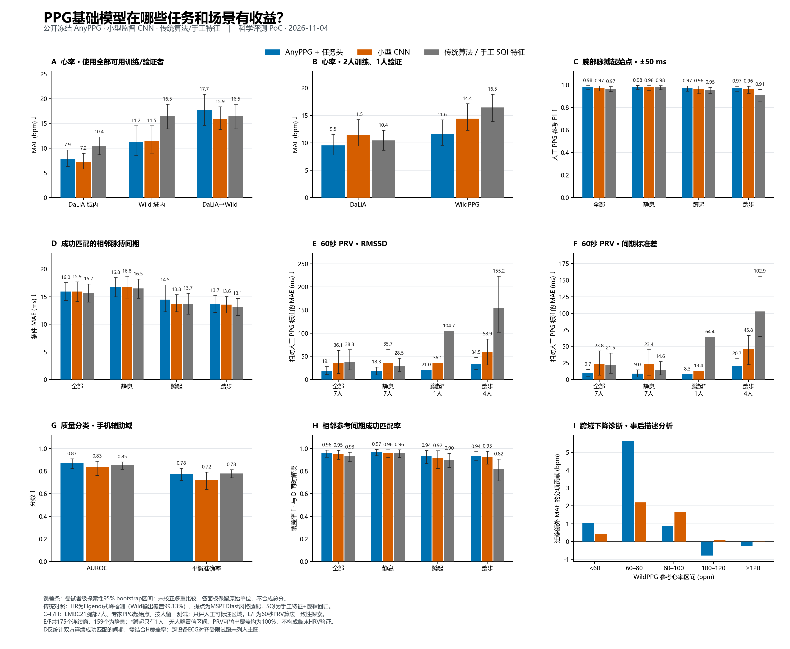

# PPG跨任务评测 逐搏 PRV 质量分类与迁移诊断

11月5日更新图中文字：心率图直接说明训练/验证者用量；“2人训练、1人验证”表示少受试者标签设置，测试人另行隔离。原数值不变。完整模型与新任务扩展的[方案和小样本证据](ppg_expansion_plan_and_pilot.md)已准备，正式扩展等待用户确认。

2026-11-04，Asia/Shanghai。本阶段沿用公开AnyPPG、小型CNN和传统算法，补充人工PPG起始点与信号质量数据，检验收益出现在哪些任务和场景。基础模型编码器保持冻结，仅训练任务头和小型监督对照。

本阶段完成7人留一测试的315份逐搏预测、60组质量分类结果与跨域HR诊断。**AnyPPG在少标签HR、人工PPG参考下的60秒PRV以及相对CNN的质量分类中显示收益；并非所有任务都更强。** 全标签HR、跨数据集HR、成功匹配后的精细间期误差仍没有普遍优势。已完成的第一阶段HR结果见[原报告](ppg_hr_poc_phase1.md)。

**模型范围说明（11月5日补充）**：本阶段和下方综合图聚焦AnyPPG；第一阶段还评了PaPaGei-S、Pulse-PPG及MOMENT，更早PPG-Bench包含PaPaGei-P和SigmaPPG。未进入本阶段的模型不能按“未测即落后”解释。完整覆盖、选择依据及Apple 2024/Google论文对照见[专题分析](ppg_model_scope_and_literature_analysis.md)。

## 跨任务对比图



图中各任务保留自己的单位与优劣方向，误差条为受试者级探索性95%区间。相同颜色表示方法类别，各任务使用相应输出头和传统对照，不表示一个未经适配的模型直接完成所有任务。不同数据、任务和标注量的结果不合成为单一总分。

[下载PNG](results/ppg_phase2/ppg_task_comparison.png) · [矢量SVG](results/ppg_phase2/ppg_task_comparison.svg) · [作图数值](results/ppg_phase2/figure_values.csv)

| 任务/场景 | AnyPPG | 小型CNN | 传统算法/手工特征 |
| :--- | ---: | ---: | ---: |
| DaLiA心率，全标签，MAE ↓ (bpm) | 7.88 | 7.24 | 10.45 |
| Wild心率，全标签，MAE ↓ (bpm) | 11.18 | 11.50 | 16.46 |
| DaLiA→Wild心率，MAE ↓ (bpm) | 17.72 | 15.87 | 16.46 |
| DaLiA心率，3人总标签预算，MAE ↓ (bpm) | 9.52 | 11.46 | 10.45 |
| Wild心率，3人总标签预算，MAE ↓ (bpm) | 11.58 | 14.45 | 16.46 |
| 人工起始点F1 ↑，±50 ms | 0.9790 | 0.9747 | 0.9662 |
| 匹配成功的相邻PP间期MAE ↓ (ms) | 15.96 | 15.92 | 15.68 |
| 相邻参考间期匹配覆盖率 ↑ | 96.19% | 95.36% | 93.26% |
| 60秒PRV RMSSD误差 ↓ (ms) | 19.13 | 36.07 | 38.32 |
| 60秒PRV间期标准差误差 ↓ (ms) | 9.73 | 23.82 | 21.53 |
| 手机PPG质量分类AUROC ↑ | 0.8723 | 0.8340 | 0.8528 |

HR沿用第一阶段三种子结果，3人预算包括验证人；传统算法无需训练标签，Wild输出覆盖99.13%，其MAE为可输出窗口上的条件误差。逐搏/PRV使用另一份腕部数据及单训练种子；质量分类为手机辅助域。后三类的完整协议和限制如下。

## DaLiA到WildPPG的下降主要集中在哪里

比较同一批WildPPG测试人和测试窗口，AnyPPG从域内拟合改为DaLiA迁移后，MAE增加**6.53 bpm [3.77, 9.20]**，16人中14人变差；CNN增加**4.37 [3.49, 5.21]**，16人均变差。这是已有预测的事后诊断，没有根据目标测试标签重新选模型或修正预测。

| 诊断证据 | 观察 | 能支持的解释 |
| :--- | :--- | :--- |
| 参考HR分布 | DaLiA受试者等权均值89.86，WildPPG为78.18 bpm；60–80 bpm在两数据中的份额分别33.20%、49.34% | 目标人群/场景的心率构成发生变化 |
| AnyPPG预测偏差 | Wild域内平均偏差+1.30，迁移为+12.49 bpm；迁移预测均值90.67 | 迁移后低HR估计偏高，与源域水平相近 |
| 心率分层 | 60–80 bpm对总迁移损失贡献+5.64 bpm | 主要问题集中在常见低HR区间 |
| 运动分层 | 低ACC三分位贡献+4.04，高ACC仅+0.15 bpm；60–80 bpm且低ACC贡献+3.12 | 不能把下降简单归因于更强运动噪声 |
| 支持范围 | 仅1.39%目标窗口超出源训练HR最小最大值；简单特征距离没有一致扩大 | 并非仅有超范围HR或所有表征都远离源数据这一种解释 |

这些证据提示**HR构成变化、低HR场景偏置和跨域预测映射失配**值得优先检查，但无法分离设备、佩戴、环境和人群的因果贡献。CNN迁移平均偏差仅+0.25 bpm，仍有较大MAE，说明一个全局偏置不足以解释全部模型的退化。后续可以在新的开发集上检验校准与数据覆盖；本批测试数据上的诊断不再作为未知盲测。

完整分层、逐人差值、参考分布和输入哈希见[迁移诊断](results/ppg_phase2/transfer/)。

## 先核实逐搏参考 再解释方法效果

**ECG峰可靠性和PPG时间配准是两件事。** DaLiA发布的ECG R峰经原作者人工校正；本轮每人均匀抽15个60秒片段，与独立XQRS核查的一致性F1为0.99249。WildPPG只有自动ECG参考；完整时长的两检测器一致性为0.90699。去除参考不可靠窗口后，300秒窗口分别保留406/425和1,640/2,592；Wild将一致性门槛提高到0.99后保留1,343窗。共识筛选不是专家裁决，也可能排除清晰ECG。[DaLiA原文](https://pmc.ncbi.nlm.nih.gov/articles/PMC6679242/)、[WildPPG原文](https://arxiv.org/html/2412.17540v1)。

原始DaLiA和Wild峰列表分别有4和7个精确重复条目。本轮原样保留原列表，另建唯一事件视图，并排除覆盖重复位置的变异性窗口。没有删除异常间期后拼接剩余峰，也没有把运动强度当作参考质量真值。

随后，严格固定时延的ECG事件试跑暴露了同步限制。仅在第一折9名训练人的51个坐姿/工作片段上做宽时延诊断，部分片段出现约1.75–2.45秒的最优配准；原0–0.6秒范围不足以覆盖。逐人最优值并不一致，而且存在心搏周期混叠，不能解释成已经确认的固定厂商延迟。官方PPG-beats评测会另做逐采集记录、逐检测器的时间配准，这与固定训练人全局时延协议不同。[时间对齐说明](https://ppg-beats.readthedocs.io/en/stable/functions/align_ppg_ecg_beats/)。

独立CPU重放确认模型概率、六层冻结特征、切窗和事件时间索引一致，未发现程序时轴错误。小CNN的局部卷积感受野约1.11秒，也不能把未处理的秒级跨模态偏移当成其提点能力问题。**该试跑完整保留作诊断，不进入综合图的有效PPG提点排名。** 对齐核查没有使用验证/测试人调整预测；也没有用事后最佳时延提高后的分数作为泛化结果。

## 人工PPG起始点与PRV参考

为得到PPG自身的时间参考，本轮补齐了Biagetti原始腕部数据与EMBC21专家标注：7名健康成人、400 Hz腕部绿光、静息/蹲起/踏步，105份采集记录。原标注有21,806个diastolic pulse onset；保守排除人工伪影区及原始缺样位置后，104份采集记录中有21,508个可评点，约277.94分钟。它直接支持PPG起始点与脉搏间期评价，不依赖ECG到PPG的时延假设。[原始数据论文](https://doi.org/10.1016/j.dib.2019.105044)、[标注发布与使用说明](https://www.eti.uni-siegen.de/ubicomp/home/datasets/embc21/index.html)。

这些是**单名专家标注的可辨认区域**，不是全部强伪影片段的完备真值；没有标注者间一致性，也没有ECG，因此PRV结果不能直接推广为ECG HRV。原生光强与血容量极性相反，人工起始点在原始光强最大处。神经模型统一使用取负的光强作为血容量方向输入，传统算法识别原始光强最大值，两者对应同一生理点位，未用测试标签选择极性。

数据读取还保留了三个细节：S4文件额外全零列不作为PPG；两个采集记录的非零原始时间起点被记录并归一到采集记录相对时间；S2的一份记录有39个孤立NaN，原始值保留，仅为完整推理构造线性插补输入，缺样位置仍从有效区域排除。训练和PRV窗口不能跨这些位置、人工伪影区或不同采集记录。105份CSV与发布的Python标注对象语义完全一致，0-based样点索引和伪影边界已经核验。

### 逐搏与PRV结果如何解释

7人LOSO每次5人训练、1人验证、1人测试；每人恰好测试一次。完整8秒人工有效上下文共2,577窗，训练每人均匀取256窗、验证取128窗。AnyPPG使用六层冻结时序特征及26,737参数任务头；随机初始化CNN为17,353参数。两者都输出64 Hz事件概率，使用固定的20轮上限、Adam 0.001、5轮耐心值，模型与阈值只由验证人的±50 ms F1选择。AnyPPG输入125 Hz，CNN输入64 Hz；中心6秒输出按原时间轴连续拼接后提点，未拼接不同采集记录。

传统对照为**MSPTDfast v2风格Python适配**，固定0.5–8 Hz滤波、6秒窗口和20%重叠，以64 Hz光强输入寻找对应onset。实现参考[PPG-beats固定版本](https://github.com/peterhcharlton/ppg-beats/tree/c397be7afc0d8a1601a85cd673718372e40f1f59)，包含许可声明；没有使用测试标签调参，也不声称逐行复现原MATLAB代码或代表全部传统方法的最优性能。

全采集记录均保留预测，评分仅取人工有效区与共同推理范围的交集，最终评到20,725个参考点。F1包含误检、漏检和空输出，先在每人内累计计数，再按7人等权平均；主容差±50 ms，±25/100 ms敏感性表一并保留。匹配间期必须在参考和预测两边都相邻，避免跨漏检计算“正确间期”。

- AnyPPG相对CNN的F1差为 **+0.00427 [−0.00064, 0.01061]**，尚不足以支持稳定领先；相对传统为 **+0.01281 [0.00857, 0.01763]**。
- 在双方共同成功匹配的参考间期上，AnyPPG相对CNN的MAE差为 **−0.005 ms [−0.278, 0.212]**；相对传统为 **+0.349 ms [0.204, 0.530]**。因此没有“精细间期定位普遍更准”的证据；传统方法略低的条件误差需要同时看其较低覆盖率。
- 60秒RMSSD误差相对CNN降低 **16.94 ms [2.12, 37.85]**，相对传统降低 **19.19 ms [7.54, 36.89]**；间期标准差误差分别降低 **14.09 [2.17, 28.43]** 和 **11.80 [2.61, 26.14] ms**。这说明本数据中保留完整脉搏序列的收益，比成功匹配后亚采样点定位差异更明显；并未独立证明其因果机制。

PRV直接对连续预测序列计算间期均值、标准差和RMSSD，不删除异常预测峰、不做插值修复或测试时配准。每个参考/预测窗口均要求至少20个间期，本次三方法可输出覆盖均为100%。从每段共同有效区左端开始按60秒切分，共175窗：静息159窗/7人、蹲起2窗/1人、踏步14窗/4人。**总体结果以静息为主，蹲起仅单人描述，不给人群区间。** 按同样规则仅有4个连续300秒窗口、来自2人，保留作附表，不作为标准5分钟HRV人群结论。数据审计中从采集记录零点切窗的158个60秒/3个300秒候选与这里的网格不同，不能混用计数。

区间按受试者重采样10,000次，未校正多重比较，单训练种子也未涵盖优化随机性；这些是探索性证据。成对PRV差值只比较共同有限窗口，成对间期误差只比较共同参考间期，完整支持范围见[逐人统计与审计](results/ppg_phase2/onsets/)及[人工参考示例](results/ppg_phase2/embc21/reference_examples.png)。

## 信号质量分类

完整BUT-PPG v2.0已补齐：50人、3,888条10秒采集记录，Good 830、Poor 3,058。任务是专家共识的**HR可读性**，采集位置为手机耳部/指端，作为辅助传感域单独展示，不代表手表形态质量判断。[官方数据说明](https://physionet.org/content/butppg/2.0.0/)。

| 方法 | AUROC及探索性95%区间 | 平衡准确率 | Good F1 |
| :--- | :--- | ---: | ---: |
| AnyPPG + 逻辑回归 | 0.8723 [0.8233, 0.9101] | 0.7772 | 0.7035 |
| 小型CNN | 0.8340 [0.7637, 0.8882] | 0.7248 | 0.6313 |
| 手工SQI特征 + 逻辑回归 | 0.8528 [0.8167, 0.8830] | 0.7807 | 0.7069 |

AnyPPG相对CNN的AUROC差为**+0.0382 [0.0099, 0.0731]**；相对手工特征为**+0.0195 [−0.0145, 0.0486]**。后者不足以支持稳定优势，手工特征的平衡准确率和F1点估计还略高。所有方法输出覆盖率100%。

协议为按人五折、三种子，每次32人训练、8人验证、10人测试；任何参数、轮数和分类阈值只由训练/验证人确定。AUROC先按每人等权的测试样本计算各种子汇总，再平均三个种子，区间用2,000次受试者bootstrap，不把采集记录当独立受试者。AnyPPG冻结；小CNN27,065参数；传统对照为20项预先固定手工SQI特征接逻辑回归。

**旧BUT输入问题已独立登记。** 48条早期数据以“300通道×1点”编码时间序列，ADC全零而物理波形非平，旧Good子集有35条受影响；另795条旧Good为RGB，固定上游选择绿通道，官方质量标注依据红通道。新任务全部使用正确解码的红通道，3,888条物理波形与wfdb独立解码完全相同。旧数据与结果没有覆盖，后续引用旧BUT下游结论必须重新核验其输入。

## 展示方式与结论范围

综合图借鉴[Apple PPG的任务比较图](https://arxiv.org/html/2312.05409v2)、[WBM的分任务结果与区间](https://arxiv.org/html/2507.00191v1)、[Google LSM的标签效率图](https://arxiv.org/html/2410.13638v1)及[SensorFM的任务分组和误差条](https://arxiv.org/html/2605.22759v1)。本项目包含bpm、毫秒、F1和AUROC，采用分面柱状图保留原始量纲。上述论文中采用分钟/小时聚合特征的任务，不作为原始PPG提点能力的证据。

当前证据限于已列数据、模型适配和受试者划分。没有同架构随机初始化消融，不能把全部差异单独归因于预训练；本阶段也没有临床诊断、血压器械验证或真实干净PPG波形恢复结论。血压/疾病筛查及配对去噪仍需各自可靠标签和对照，不将它们画成已有结果。

AnyPPG论文列出的五份预训练来源未列EMBC21/Biagetti或BUT-PPG；但是BUT质量分类已用于原论文下游开发评测，本轮不是开发者未知的新盲测。论文BUT样本口径为3,840，本轮修复早期编码格式后采用完整3,888条，且划分、任务头和统计协议不同，不把两者数值直接当作复现误差。[AnyPPG原文及数据表](https://arxiv.org/html/2511.01747v4)

下一步最有价值的是在独立腕部人工提点数据上复核PRV收益，并补充训练种子与同架构随机权重消融；跨域HR优先检验低HR覆盖和开发集校准。质量分类已完成，可作为后续去噪评价的辅助维度。血压和疾病任务继续沿既有计划先解决患者隔离与标签/预训练重合问题，暂不开展基础模型预训练。

## 复现与验证

所有模型权重、原始波形、逐样本概率和训练缓存留在本机；Git只保存代码、协议、审计、逐人统计及综合图。新下载的人工提点与完整BUT数据没有覆盖旧PPG-Bench目录。数据源、恢复地址、压缩包哈希和解包结构见[数据与证据清单](results/ppg_phase2/evidence_copy_manifest.json)。EMBC21读取脚本本身不下载数据，按清单先恢复两份公开压缩包，再运行审计。

沿用独立`.local/ppg-bench-venv`中的固定PPG-Bench/AnyPPG依赖；Python 3.12.7、Torch 2.5.1+cu124，GTX 1660 SUPER 6 GB，神经适配FP32。没有安装新依赖或恢复旧全套队列。下列命令中的`python`应指向该独立环境；项目测试用项目`.venv`。

```powershell
python scripts/ppg_embc21_data.py
python scripts/run_ppg_onset_poc.py --stage all
python scripts/summarize_ppg_onset_poc.py
python scripts/ppg_sqi_poc.py --stage download
python scripts/ppg_sqi_poc.py --stage prepare
python scripts/ppg_sqi_poc.py --stage register
python scripts/ppg_sqi_poc.py --stage features
python scripts/ppg_sqi_poc.py --stage run
python scripts/ppg_sqi_poc.py --stage summarize
python scripts/analyze_ppg_hr_transfer.py
python scripts/plot_ppg_task_comparison.py
```

已完成数据身份、划分、特征缓存、权重和全部输出哈希核验；315份逐搏预测和60份SQI结果无缺项。逐搏CPU独立重推的概率最大差小于`6.3e-6`，最终三个方法事件时间均精确一致；独立整数时间格匹配和原始公式复算17,073项标量，最大差`5.68e-14`。SQI独立逻辑回归重拟合最大概率差`3.33e-16`，独立指标复算最大差`1.79e-14`。本机完整149项测试通过。完整运行环境、审计和独立重放证据分别在[onsets](results/ppg_phase2/onsets/)、[SQI](results/ppg_phase2/sqi/)及[ECG诊断](results/ppg_phase2/diagnostic_ecg/)。综合图可直接由Git中已发布统计表重绘，不需要原始数据或GPU。
